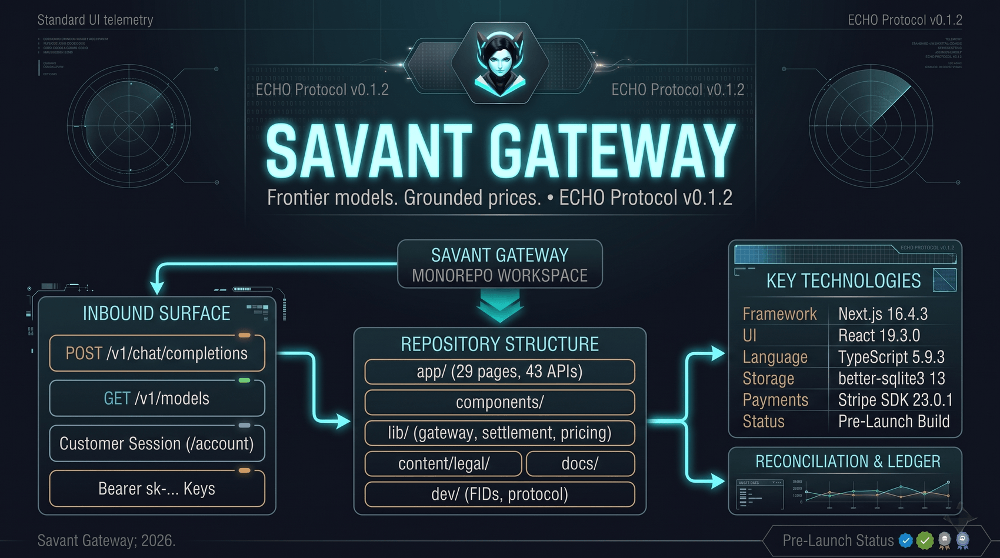

<!-- markdownlint-disable MD041 -->
<!-- markdownlint-disable MD033 -->
<div align="center">



**An independent inference gateway with a priced, accountable product layer,
plus Signal: a free AI content surface that links every story to the models it
names.**

One OpenAI-compatible endpoint over OpenAI Chat Completions and Anthropic
Messages, prepaid credit and subscriptions, account-owned keys, an operator
console that keeps cost and revenue separate, and a public content reader built
around the same catalog.

[](https://nextjs.org/)[](https://react.dev/)[](https://www.heroui.com/)[](https://www.typescriptlang.org/)[](https://www.postgresql.org/)[](dev/echo-v0.1.2-single-agent.md)[](LICENSE)[](docs/project-status.md)

</div>

> **Pre-launch software, published in the open.** The gateway, billing ledger,
> customer accounts, subscriptions, operator console, model identity checks and
> Signal content surface are implemented in this tree. No live card payment,
> funded paid inference, legal review or final offering is claimed. Every claim
> below describes code that exists; limitations are named rather than hidden.
> [docs/project-status.md](docs/project-status.md) holds the current evidence
> boundaries.

---

## Get Started

```bash
git clone https://github.com/savant0x/savant-gateway.git
cd savant-gateway
npm install
cp .env.example .env.local
```

For local development, leave `DATABASE_URL` blank. The app starts an embedded
PostgreSQL engine (PGlite) in `data/pg`; this is a real PostgreSQL dialect, not
SQLite. Set an upstream key and the two operator values:

```bash
PROVIDER_KEY=...
ADMIN_PASSWORD=...          # 12+ characters
ADMIN_SESSION_SECRET=...    # 32+ characters
```

Generate the session secret:

```bash
node -e "console.log(require('node:crypto').randomBytes(24).toString('base64url'))"
```

```bash
npm run dev
```

Open `http://localhost:3000`, sign in at `/admin/login`, go to **Admin →
Providers**, and press **Sync**. Until a sync completes, `/models` is empty and
`/v1/models` returns nothing — an empty catalog is the honest state, not a bug.

The full first-run path is in [docs/getting-started.md](docs/getting-started.md).

### Environment

| Variable | Required | Purpose |
| --- | --- | --- |
| `DATABASE_URL` | Production | Networked `postgres://` or `postgresql://` URL. The server refuses to start in production without it. Use the provider's pooled URL on Vercel. |
| `PG_LOCAL_PATH` | No | Local PGlite directory when `DATABASE_URL` is blank. Defaults to `data/pg`. |
| `NEXT_PUBLIC_SITE_URL` | Production | Canonical origin for metadata, sitemap/robots, cookies and Stripe redirects. Must be `https://` and non-loopback. |
| `ADMIN_PASSWORD` | Production | 12+ characters; enables `/admin`. |
| `ADMIN_SESSION_SECRET` | Production | 32+ characters; signs the admin cookie. |
| `PROVIDER_KEY` | Gateway | Default upstream credential. Server-only. |
| `COMMANDCODE_API_KEY`, `APIXOAI_API_KEY` | Optional | Further upstreams. Provider rows store the variable *name*, never the value. |
| `STRIPE_SECRET_KEY`, `STRIPE_WEBHOOK_SECRET` | For cards | Absent, card checkout returns `503`; nothing invents credit. |
| `STRIPE_EXPECTED_LIVEMODE` | Recommended | A delivery whose livemode disagrees is quarantined without credit. |
| `NOWPAYMENTS_TOPUPS_ENABLED` | For crypto | Default `false`. Credentials alone never enable the lane. |
| `NOWPAYMENTS_API_KEY`, `NOWPAYMENTS_IPN_SECRET` | For crypto | NOWPayments credentials. `NOWPAYMENTS_SANDBOX=true` targets the sandbox. |
| `PLAN_SALES_ENABLED` | Launch switch | `false` by default: plans stay out of the catalog and checkouts are refused. |
| `TRIAL_ENABLED` | Launch switch | `false` by default; a trial grant also needs a budget and explicit model pairs. |
| `CONTENT_ENABLED` | No | Signal is on unless this is `false`. |
| `CONTENT_INGEST_ENABLED` | Scheduled ingestion | `false` by default. Gates the cron route, not an explicit admin fetch. |
| `CONTENT_CRON_SECRET` | Cron | Bearer/`x-content-secret` value for `/api/cron/content`. |
| `YOUTUBE_API_KEY` | Optional | Adds likes and YouTube comment counts. Channel ids and `@handles` work without it. |
| `GITHUB_TOKEN` | Optional | Raises the public GitHub rate limit for repository facts and READMEs. |
| `GATEWAY_DISPOSABLE_START` | Tests only | Never set on a real deployment. `/api/ready` reports `mode: "disposable"` when set. |

[`.env.example`](.env.example) is the complete inventory, including free-pool,
rate, operations, email, promo, benchmark and backup settings.

---

## What It Does

### Gateway

- **One endpoint, two wire protocols.** `POST /v1/chat/completions` accepts an
  OpenAI-shaped request and routes it to a provider that speaks either OpenAI
  Chat Completions or Anthropic Messages, streaming or buffered, translating the
  payload and the response in both directions.
- **Protocol chosen per model.** A provider registered as `both` resolves each
  model through its `supported_endpoints`; models with no servable endpoint are
  never catalogued.
- **Honest identity.** Publicly every model is `owned_by: "savant-gateway"`.
  Upstream identity is internal routing metadata, and non-default providers
  namespace their ids as `{slug}/{upstream_id}`.
- **Scoped provider sync.** Rows are keyed by `(upstream_slug, upstream_id)` and
  a sync only delists that provider's vanished rows, so one failing upstream can
  never empty another's catalog.
- **Truthful model states.** A model that vanishes upstream becomes
  `in_catalog = 0` rather than a deletion, keeping its prices, usage and history.
- **Provider-scoped pricing.** The operator sets sell prices in USD per 1M
  tokens with markup; free groups stay zero-priced and manual group assignments
  survive a sync.

### Billing and credit

- **Integer micro-dollars everywhere.** `1_000_000 = $1.00`; cost, sell price,
  margin and blended profit are derived, never stored redundantly.
- **Hold, then settle.** A paid call reserves an estimated hold; one transaction
  on completion, failure or stream close releases the hold, debits the actual
  charge, and writes revenue plus upstream cost. An over-run can leave a balance
  negative and the next call is refused with `402`.
- **Durable settlement.** Interrupted settlement is recoverable from the open
  hold rather than lost; reconciliation surfaces drift to an operator.
- **Webhook-confirmed top-ups.** Stripe card top-ups credit only from a signed
  webhook; `success_url` grants nothing. NOWPayments crypto top-ups are isolated
  behind their own credentials and switch.
- **Idempotent billing events.** Subscriptions and invoices are claimed by Stripe
  event id, so a retried invoice activates once and a livemode mismatch is
  quarantined instead of credited.
- **Promo credit behind a switch.** Redeeming a code grants prepaid dollar
  credit once through the same ledger; the weighted-token free pool is separate.
- **Free, subscription and paid tiers** driven by a model group's billing mode,
  including a per-user daily free allowance, provider floor admission, and
  explicit `block`-or-`credit` overage policy.

### Accounts, plans and operator controls

- **Customer accounts** with scrypt password hashes and server-side sessions:
  only a SHA-256 hash of the opaque session token is stored, and sign-out revokes
  it server-side.
- **Account-owned API keys**, stored only as SHA-256 hashes, listed masked, and
  revocable; every account route is scoped by session user.
- **Subscription snapshots.** Activation copies the plan's models, allowance and
  overage policy onto the subscription, so editing a plan later cannot rewrite a
  purchase that already happened.
- **Operator console** for overview, customers, catalog, groups, plans,
  subscriptions, providers, pricing, analytics, reconciliation, support,
  operations, content and identity.
- **Policy versions.** `/terms`, `/privacy`, `/refunds` and `/acceptable-use`
  publish the current version; every published version remains at
  `/legal/<version>/<slug>`, and signup records acceptance.
- **Operations.** Durable incidents, bounded rules, a signed alert webhook with
  retry/backoff, and pause/drain controls.

### Signal — the content surface

Signal is free AI news, papers, repositories, discussions and videos. It is not
sold, and every item links back to its publisher. The catalog link is the
purchase path: each story shows the models it names with live prices.

- **Four source kinds.** RSS/Atom feeds, YouTube channels, HuggingFace Daily
  Papers, and Trendshift's repository listing. Sources are operator-managed from
  **Admin → Content**; five consecutive failures disable a source, while
  ingestion never throws into a page render.
- **Recoverable presets.** The six committed aggroNATION rows, four inferred
  canonical feeds, and the two YouTube handles recovered from the retired site
  can be added in one click. Seeding is idempotent on URL and never edits an
  existing source.
- **Full-text reader.** When a feed carries only a link, a metadata template or
  a short blurb, the first detail view fetches the publisher page, extracts the
  article region, sanitizes it, stores it, and later views do not refetch.
  Hacker News `Article URL:` templates never become the body.
- **Honest publisher limits.** FT and other publishers that return HTTP 403 are
  named as blocked and keep their excerpt plus an outbound original link. The
  gateway does not proxy around paywalls or access controls.
- **Repository cards and READMEs.** Open Source Projects and Trendshift items
  resolve GitHub facts from the URL, an `owner/repo` title, or a link in the feed
  body. Stars, forks, language, license, topics, homepage and the rendered README
  are stored in `github_json`; the README is sanitized, and relative images and
  links resolve to GitHub. Missing facts are repaired once on the first detail
  view.
- **Video pages and modal.** A video thumbnail opens the YouTube player in a
  modal, and the detail page has the player, description, views, likes, rating,
  YouTube comment count, source facts and related reading.
- **Community and discovery.** Public comments on each item, saved items for
  signed-in customers, a UTC-day digest, a dated digest archive, a model
  briefing, topic pages, search and pagination.
- **Model linking.** Automatic links require an exact title or publisher tag
  alias; an operator can override or dismiss them. Editing a link is permanent
  across re-fetches.
- **Bounded ingestion.** 15-second timeout, 2 MiB response ceiling, per-source
  item cap and a cycle record that closes with counts or an error.

### Model identity checks

The identity surface is deliberately advisory, not a “genuine model” badge.

- **A fixed battery** exercises protocol shape, determinism, response
  distributions, canary leakage, exact-answer canaries, context retrieval, tool
  conformance, stream integrity and optional logprobs.
- **Scoped states** distinguish `consistent`, `self_consistent`, `baseline`,
  `inconclusive`, `divergent_review`, `mismatch_confirmed`, `stale`, `unsupported`
  and `error`. A result has a scope, a date and an expiry.
- **Operator runs** are recorded in the admin identity console with evidence,
  verdicts, references, cost estimates and gates. Public pages publish the
  method and corrections; they do not claim physical weight authenticity.
- **No blocked billing path.** Identity work reads projections and never sits in
  admission, holds, settlement or credit.

### Catalog and benchmarks

- Public catalog, docs, plans and comparison pages rendered from live state.
- Stored Artificial Analysis benchmarks with admin sync controls and provenance.
- Searchable, sortable, paginated catalog with sell prices and group labels.
- Brand images and per-page social cards generated from the content they
  describe.

---

## Surfaces

| Route | Access | Purpose |
| --- | --- | --- |
| `/` | Public | Landing page with live catalog counts and a request sample. |
| `/models`, `/models/[...id]` | Public | Searchable catalog and individual model pages. |
| `/compare` | Public | Benchmark comparison with provenance. |
| `/docs`, `/docs/start`, `/docs/faq` | Public | API reference, newcomer guide and FAQ. |
| `/plans` | Public | Active plans and inclusions while sales are closed. |
| `/signal`, `/signal/[id]` | Public | Signal feed and reader. |
| `/signal/digest`, `/signal/digest/[date]` | Public | Today's digest and the dated archive. |
| `/signal/briefing` | Public | Model briefing built from recent content. |
| `/signal/saved` | Customer | Saved items. |
| `/signal/topics/[tag]` | Public | Topic listing. |
| `/identity` | Public | Identity methodology, states and corrections. |
| `/account` | Customer | Balance, plan, keys, usage, ledger, policies, support. |
| `/signup`, `/login`, `/recover` | Public | Account creation, sign-in and recovery. |
| `/support` | Public / customer | Support entry point and queue. |
| `/admin/*` | Admin | Full operator control plane, including content and identity. |
| `/v1/*` | Consumer key | The OpenAI-compatible gateway. |
| `/api/health`, `/api/ready` | Public probe | Liveness and truthful readiness. |

46 page routes and 63 route handlers back these surfaces, plus generated
`sitemap.xml`, `robots.txt`, social cards and the web manifest. The sitemap and
robots routes read `NEXT_PUBLIC_SITE_URL` per request, so the canonical origin is
the deployed one.

---

## Deploying on Vercel

Vercel can host the application because production storage is PostgreSQL, not a
local file. The local PGlite engine is for development only; `instrumentation.ts`
refuses a production start without a networked `DATABASE_URL`.

1. **Create a PostgreSQL database.** Neon is a good fit: use its pooled
   connection string. Any standard PostgreSQL 15+ provider works. Apply the
   additive migrations by starting the app once with the URL set.
2. **Add the production environment.** At minimum:

   ```bash
   vercel env add DATABASE_URL production
   vercel env add NEXT_PUBLIC_SITE_URL production   # https://savant-gateway.vercel.app
   vercel env add ADMIN_PASSWORD production
   vercel env add ADMIN_SESSION_SECRET production
   ```

   Add the provider key and any payment/content keys you use. Use the pooled
   database URL so serverless instances do not exhaust connections.
3. **Deploy.**

   ```bash
   vercel --prod
   ```

4. **Verify readiness.**

   ```bash
   curl -fsS https://<domain>/api/ready
   ```

   It must return `200` with `checks.configuration: "ok"` and
   `checks.storage: "ok"`. A missing or invalid value fails at startup with
   issue codes such as `db_missing`, `origin_missing` or `admin_unconfigured`.
   `/api/health` is liveness only; `/api/ready` is the truthful probe.

The build logs may show two npm warnings on Vercel: an unknown `cache-dir` env
config and install scripts for `better-sqlite3`/`unrs-resolver`. Neither is a
build failure. A deployment that returns 500 on every route is normally the
startup gate rejecting a missing `DATABASE_URL`, not a compile error.

`GATEWAY_DISPOSABLE_START` and `NEXT_MANUAL_SIG_HANDLE` must never be set on
production. The first is for disposable test suites; the second disables drain.

The older [deployment runbook](docs/deployment-runbook.md) describes the
superseded single-process SQLite/Fly topology. The current storage contract is
PostgreSQL, and the README above is the Vercel path.

---

## Quality Gates

```bash
npm run check             # eslint + tsc --noEmit
npm run storage:check     # store/dialect contract
npm run config:check      # validator; PASS (non-production) outside production
npm run config:check:prod # operator gate; enforces the production inventory
npm test                  # node --test "tests/*.test.mjs"
npm run quality           # 400-line file ceiling
npm run build             # next build
npm run test:http         # HTTP suites against a disposable database
npm run test:recovery     # backup/restore/reconciliation drill

npm run verify            # all of the above except config:check:prod
```

The pre-push hook runs the attribution guard plus `npm run verify` and fails
closed. CI runs the same set on every push and pull request; a separate workflow
rejects coding-agent attribution anywhere in commit history.

The current unit suite is 824 tests (823 passing, 1 skipped) on this tree. The
full HTTP/recovery receipt is recorded in [CHANGELOG.md](CHANGELOG.md); run
`npm run verify` before publishing a release rather than treating an earlier
receipt as current.

---

## Repository

```text
app/                    pages and route handlers
  signal/                public content feed, reader, digest, briefing, saved
  identity/              public identity methodology
  admin/(panel)/         operator console, including content and identity
  api/                   customer, admin, content, cron, webhooks, gateway
components/              landing, catalog, account, admin, content, identity, legal
lib/content/             sources, feeds, reader, GitHub README, digest, store/
lib/identity/            battery, fingerprints, runs, verdicts, public projection
lib/storage/             PostgreSQL adapter, migrations, store modules
lib/                     gateway, settlement, pricing, plans, providers
content/legal/           published policy text, one directory per version
docs/                    launch plan, policies, runbooks, research
dev/                     FIDs, audits, session summaries, protocol
tests/                   Node test-runner suites
scripts/                 quality, attribution, HTTP, config, backup and import gates
public/images/           brand images at fixed names
```

Reference copies of other projects live under `resources/`; they are ignored and
never imported from.

---

## Current Limits

- **Pre-launch.** The Vercel project is linked, but production requires the
  `DATABASE_URL` and operator values above. A deployment without them refuses to
  start by design.
- **No live payment acceptance.** No real card payment, funded paid inference,
  recurring invoice or crypto settlement is claimed. Stripe and NOWPayments
  paths are tested against disposable/local fixtures.
- **No legal review.** The operator is not a separate legal entity; the published
  policies say so.
- **No email delivery by default.** Verification and recovery routes exist only
  when an email transport is configured.
- **Rate limiting is in-memory.** On serverless, each instance has its own
  buckets; the database ledger remains authoritative for money, but admission is
  approximate under concurrency.
- **No provider failover.** Each model has one provider; a failed provider fails
  its own models rather than rerouting.
- **Content is third-party and free.** Publishers control access. A blocked
  publisher keeps its excerpt and outbound link; the gateway does not bypass a
  paywall.
- **One plan per customer.** No stacking, proration, tax calculation or dunning
  beyond Stripe's own lifecycle.
- **English only**, with US processing disclosed in the privacy policy.

---

## Documentation

| Document | What it answers |
| --- | --- |
| [docs/project-status.md](docs/project-status.md) | Verified state, evidence boundaries, launch gates. |
| [docs/getting-started.md](docs/getting-started.md) | Local setup, first provider sync, first request. |
| [docs/operator-first-run.md](docs/operator-first-run.md) | Operator console first-run checklist and safety rails. |
| [docs/deployment-runbook.md](docs/deployment-runbook.md) | Historical Fly/SQLite runbook; superseded by the Vercel/PostgreSQL path above. |
| [docs/hosting-decision.md](docs/hosting-decision.md) | Historical hosting decision record. |
| [docs/troubleshooting.md](docs/troubleshooting.md) | Common local, config, gate and deployment failures. |
| [docs/research/aggronation-sources.md](docs/research/aggronation-sources.md) | Recovered content sources and their live parser probes. |
| [docs/research/fingerprint.md](docs/research/fingerprint.md) | Model identity research and the statistical evidence boundary. |
| [SECURITY.md](SECURITY.md) | Threat model, session and key handling, origin checks. |

The app also serves customer-facing documentation at `/docs`, `/docs/start` and
`/docs/faq`.

---

## License

Apache License 2.0 — see [LICENSE](LICENSE) and [NOTICE](NOTICE).

The HeroUI template portions described in [NOTICE](NOTICE) remain under their
original MIT terms.
