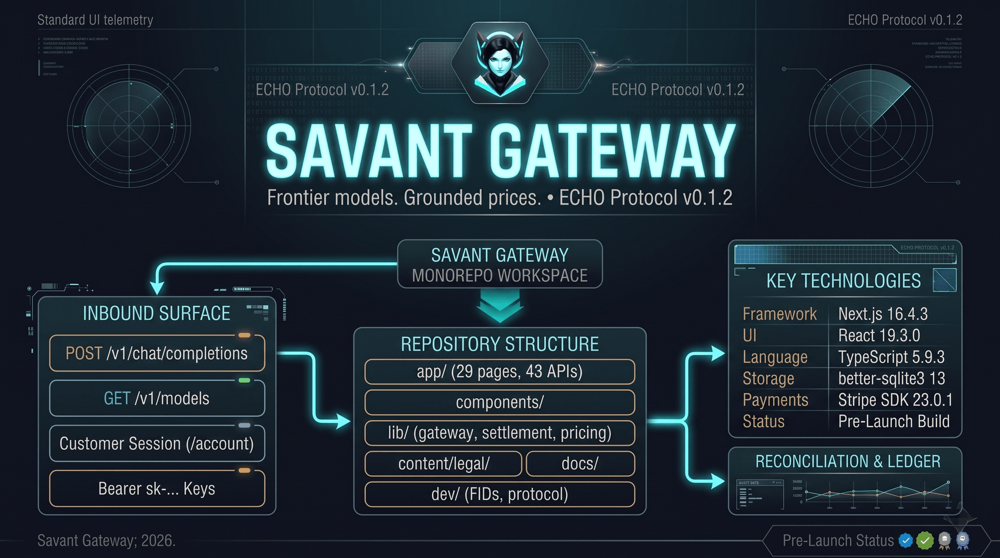

<!-- markdownlint-disable MD041 -->
<!-- markdownlint-disable MD033 -->
<div align="center">



**An independent inference gateway that puts a priced, accountable product layer
in front of one or more upstream providers.**

One OpenAI-compatible endpoint over OpenAI Chat Completions and Anthropic
Messages, prepaid credit with a real ledger, account-owned keys, and an operator
console that never confuses upstream cost with revenue.

[](https://nextjs.org/)[](https://react.dev/)[](https://www.heroui.com/)[](https://www.typescriptlang.org/)[](https://github.com/WiseLibs/better-sqlite3)[](dev/echo-v0.1.2-single-agent.md)[](LICENSE)[](docs/project-status.md)

</div>

> **Pre-launch software, published in the open.** This repository is step 1 of a
> multi-step build. Nothing is deployed, no domain is attached, and no plan is
> sold. Subscriptions are implemented behind an enforced no-sales state, SQLite
> is a local development placeholder that must be replaced before any hosted
> deployment (see [docs/database-options.md](docs/database-options.md)), and the
> customer policies are published but not counsel-reviewed. Every claim below
> describes code in this tree; where something is unverified it is named as a
> limitation rather than a capability. [docs/launch-plan.md](docs/launch-plan.md)
> holds the gates that stand between here and service.

---

## Get Started in 30 Seconds

```bash
git clone https://github.com/savant0x/savant-gateway.git
cd savant-gateway
npm install
cp .env.example .env.local
```

Set three values in `.env.local` — an upstream key, an admin password of 12+
characters, and a 32+ character session secret:

```bash
node -e "console.log(require('node:crypto').randomBytes(24).toString('base64url'))"
```

```bash
npm run dev
```

### Environment

| Variable | Required | Purpose |
| --- | --- | --- |
| `PROVIDER_KEY` | Yes | Default upstream credential. Server-only. |
| `COMMANDCODE_API_KEY`, `APIXO_API_KEY` | Optional | Further upstreams. Provider rows store the variable *name*, never the value. |
| `ADMIN_PASSWORD` | For `/admin` | 12+ characters, compared in constant time. |
| `ADMIN_SESSION_SECRET` | For `/admin` | 32+ characters, signs the admin cookie. |
| `NEXT_PUBLIC_SITE_URL` | Production | Canonical origin for metadata and Stripe redirects. |
| `STRIPE_SECRET_KEY`, `STRIPE_WEBHOOK_SECRET` | For billing | Absent, checkout returns `503`; nothing else invents credit. |
| `STRIPE_EXPECTED_LIVEMODE` | Recommended | A delivery whose livemode disagrees is quarantined without credit. |
| `PLAN_SALES_ENABLED` | Launch switch | `false` by default: plans stay out of the catalog, checkouts are refused, publishing for purchase is blocked. |
| `TRIAL_ENABLED` | Launch switch | `false` by default; a trial grant needs a token budget and explicit model pairs. |
| `ARTIFICIAL_ANALYSIS_API_KEY` | Optional | Adds the benchmark column; blank hides it and changes nothing else. |
| `DB_PATH` | No | SQLite file, defaults to `./data/gateway.db`. |

[`.env.example`](.env.example) documents the free-pool allocation, RPM and
concurrency ceilings, provider floor, and staleness windows.

### Deploying

This gateway is one process writing one SQLite file, and it is meant to be
hosted that way: WAL mode requires every reader and writer on the same host and
filesystem. `Dockerfile`, `.dockerignore` and `fly.toml` package that as a single
machine with a persistent volume, a readiness check on `/api/ready`, and no
autoscaling. [docs/deployment-runbook.md](docs/deployment-runbook.md) is the
procedure and the environment inventory; [docs/hosting-decision.md](docs/hosting-decision.md)
records why a serverless or multi-replica host is rejected. Nothing here is
deployed yet, and the image has not been built.

Open `http://localhost:3000`, then sync a provider so the catalog is populated:
sign in at `/admin/login`, go to **Admin → Providers**, and press **Sync**. Until
a sync completes, `/models` is empty and `/v1/models` returns nothing — an empty
catalog is the honest state, not a bug.

Then mint a key on `/account`, or in development use the operator console at
`/dashboard`, and call the gateway:

```bash
curl http://localhost:3000/v1/models -H "Authorization: Bearer sk-..."

curl http://localhost:3000/v1/chat/completions \
  -H "Authorization: Bearer sk-..." \
  -H "Content-Type: application/json" \
  -d '{"model":"<id from /v1/models>","messages":[{"role":"user","content":"ping"}]}'
```

`/signup` creates a customer account, which requires accepting the current
policies; `/account` is where a customer sees balance, plan, keys, usage and
ledger. In a production build `/dashboard` redirects to `/admin/login`; the
development loopback bypass is disabled. See [SECURITY.md](SECURITY.md).

---

## Overview

Savant Gateway is a Next.js application, not a proxy script. It owns the
commercial surface — catalog, prices, credit, keys, ledger, entitlements,
support — and speaks whatever protocol each registered upstream actually
implements.

```
caller ──► account key ──► model ──► billing path ──► provider ──► settlement
```

The design constraint throughout: **three numbers that must never be confused.**
Upstream cost, our sell price, and charged revenue live in separate columns, so
margin, breakage and refunds stay auditable instead of being inferred from one
"revenue" field.

The whole project ships under [ECHO Protocol v0.1.2](dev/echo-v0.1.2-single-agent.md)
— FID-bound work, a Perfection Loop before code, and a verification receipt
recorded in [CHANGELOG.md](CHANGELOG.md) that separates what was run from what
was not.

---

## Key Technologies

| Layer | Tech | Version |
| --- | --- | --- |
| Framework | Next.js App Router, route handlers | 16.4.3 |
| UI | React + HeroUI, Tailwind CSS 4 | 19.3.0, 3.2.7, 4.3.3 |
| Language | TypeScript (`strict`) | 5.9.3 |
| Runtime | Node | `>=22.18.0` |
| Storage | SQLite via `better-sqlite3` (dev placeholder) | 13.0.3 |
| Payments | Stripe Checkout, Subscriptions, Billing Portal | SDK 23.0.1 |
| Icons | Font Awesome Free | ^6.7.2 |
| Package manager | npm | lockfile committed |

---

## Features

### Gateway

- **One endpoint, two wire protocols.** `POST /v1/chat/completions` accepts an
  OpenAI-shaped request and routes it to a provider that speaks either OpenAI
  Chat Completions or Anthropic Messages, streaming or buffered, translating the
  payload and the response in both directions.
- **Protocol chosen per model.** A provider registered as `both` resolves each
  model through its `supported_endpoints`; models with no servable endpoint are
  never catalogued.
- **Honest identity.** Publicly every model is `owned_by: "savant-gateway"`.
  Upstream identity is internal routing metadata, and non-default providers
  namespace their ids as `{slug}/{upstream_id}`.
- **Scoped provider sync.** Rows are keyed by `(upstream_slug, upstream_id)` and
  a sync only delists that provider's vanished rows, so one failing upstream can
  never empty another's catalog.
- **Truthful model states.** A model that vanishes upstream becomes
  `in_catalog = 0` rather than a deletion, keeping its prices, usage and history.

### Billing and credit

- **Integer micro-dollars everywhere.** `1_000_000 = $1.00`; prices are edited in
  USD per 1M tokens, with cost, sell price, margin and blended profit derived,
  never stored redundantly.
- **Hold, then settle.** A paid call reserves an estimated hold; one transaction
  on completion, failure or stream close releases the hold, debits the actual
  charge, and writes revenue plus upstream cost. A hold is admission control, not
  a ceiling — an over-run debits and can leave a balance negative, and the next
  call is refused with `402`.
- **Durable settlement.** Interrupted settlement is recoverable from the open
  hold rather than lost, and reconciliation surfaces drift to an operator instead
  of silently correcting balances.
- **Top-ups credit only from a signed webhook.** `success_url` grants nothing;
  `topups.provider_ref` is unique; a replayed event is a `200` no-op. With Stripe
  unconfigured, checkout returns `503` and there is no synthetic credit path.
- **Idempotent billing events.** Subscriptions and invoices are claimed by Stripe
  event id, so a retried invoice activates once and never re-opens a period, and
  a delivery whose livemode disagrees with the declared environment is
  quarantined instead of credited.

### Accounts and access

- **Customer accounts** with scrypt password hashes and server-side sessions:
  only a SHA-256 hash of the opaque session token is stored, and sign-out revokes
  it server-side.
- **Account-owned API keys**, stored only as SHA-256 hashes, listed masked, and
  revocable; every account route is scoped by session user, so one customer
  cannot read or revoke another's key.
- **Free, subscription and paid tiers** driven by a model group's billing mode,
  including per-user daily free allowance, provider remaining-floor admission,
  and explicit `block`-or-`credit` overage policy.
- **Subscription snapshots.** Activation copies the plan's models, allowance and
  overage policy onto the subscription, so editing a plan later cannot rewrite a
  purchase that already happened.
- **Enforced no-sales launch state.** Plan authoring, entitlement math and Stripe
  lifecycle code all exist behind `PLAN_SALES_ENABLED`, which is off: plans stay
  out of the public catalog, new checkouts are refused, and a plan cannot be
  published for purchase. Existing grants, invoices and the customer portal keep
  working, so the switch closes the storefront rather than the billing code.

### Operator surfaces

- Revenue, cost, margin, blended profit and token analytics over 7/30/90 days.
- Inline pricing with markup, per-row manual override, and bulk repricing.
- Provider registry with credential-variable names (never values), capability
  flags, connection test and scoped sync.
- Catalog, groups, plans, subscribers, credit grants, reconciliation, support
  queue, and benchmark comparison.
- **Benchmark integrity.** Published benchmark figures are parsed from named
  sources with provenance; missing data stays absent rather than being estimated,
  and a partial or impossible record is rejected rather than displayed.

### Customer experience

- Public catalog, docs, plans and comparison pages rendered from live state.
- Versioned policies at `/terms`, `/privacy`, `/refunds`, `/acceptable-use`, with
  every published version permanently reachable at `/legal/<version>/<slug>`.
- Version-keyed policy acceptance: signup refuses an account without it, existing
  accounts are asked on `/account`, and accepting a new version preserves the old
  record.

---

## Surfaces

| Route | Access | Purpose |
| --- | --- | --- |
| `/` | Public | Landing page with live catalog counts and a request sample. |
| `/models` | Public | Searchable, sortable, paginated catalog with sell prices. |
| `/compare` | Public | Benchmark comparison with provenance. |
| `/docs` | Public | API reference: auth, payload, catalog vocabulary, errors. |
| `/plans` | Public | Active plans, inclusions and allowance — while sales are closed. |
| `/terms`, `/privacy`, `/refunds`, `/acceptable-use` | Public | Current published policy versions. |
| `/legal/<version>/<slug>` | Public | Every published policy version, permanently. |
| `/support` | Public / customer | Support entry point and queue. |
| `/signup`, `/login` | Public | Customer account creation and sign-in. |
| `/account` | Customer session | Balance, plan, top-ups, keys, usage, ledger, acceptance. |
| `/dashboard` | Operator console | Provider, catalog, local-tenant keys, tester, usage. |
| `/admin/*` | Admin session | Overview, customers, catalog, groups, plans, subscriptions, providers, pricing, analytics, reconciliation, support. |
| `/v1/*` | Consumer key | The OpenAI-compatible gateway. |

43 route handlers and 29 pages back these surfaces. Customer pages and the
operator console are strictly separate namespaces, and every operator page and
API sends `Cache-Control: no-store` with `noindex`.

<details>
<summary><strong>API surface</strong> — 43 handlers</summary>

**Gateway**

| Method | Path | Auth |
| --- | --- | --- |
| `POST` | `/v1/chat/completions` | Consumer key |
| `GET` | `/v1/models` | Consumer key |

**Customer**

| Method | Path | Auth |
| --- | --- | --- |
| `POST` | `/api/auth/signup` | Public, same-origin |
| `POST` | `/api/auth/login` | Public, same-origin |
| `POST` | `/api/auth/logout` | Session |
| `GET` | `/api/auth/me` | Session |
| `GET` `POST` | `/api/account/keys` | Session, same-origin for mutations |
| `DELETE` | `/api/account/keys/:id` | Session, same-origin |
| `POST` | `/api/account/topup` | Session, same-origin |
| `GET` `POST` | `/api/account/subscription` | Session, same-origin for mutations |
| `POST` | `/api/account/subscription/cancel` `resume` `portal` | Session, same-origin |
| `GET` `POST` | `/api/account/policies` | Session |
| `GET` `POST` | `/api/account/support` | Session |
| `GET` | `/api/account/trial` | Session |
| `GET` | `/api/plans` | Public |
| `POST` | `/api/webhooks/stripe` | Stripe signature |
| `GET` | `/api/health`, `/api/ready` | Public probe |

**Operator** — all require an admin session in production.

| Area | Paths |
| --- | --- |
| Session | `/api/admin/session` |
| Catalog | `/api/admin/models`, `/api/admin/pricing`, `/api/admin/groups` |
| Providers | `/api/admin/providers`, `/:slug`, `/:slug/test`, `/:slug/sync`, `/sync` |
| Plans | `/api/admin/plans` |
| Subscriptions | `/api/admin/subscriptions` |
| Money | `/api/admin/credit`, `/api/admin/adjustments`, `/api/admin/reconciliation`, `/api/admin/settlements`, `/api/admin/payments` |
| Runtime | `/api/admin/gateway`, `/api/provider/runtime`, `/api/provider/sync` |
| Integrity | `/api/admin/benchmarks`, `/api/admin/support` |
| Console | `/api/keys`, `/api/models`, `/api/usage` (loopback in development only) |

</details>

---

## How it works

```text
browser / SDK
   │  Authorization: Bearer sk-…
   ▼
POST /v1/chat/completions
   │  hash key → active key + active user
   │  resolve model → provider + protocol + active + in catalog
   │  past-due plan? → 402 before any billing path
   │  covered by the active plan snapshot?
   │     yes → allowance fits → reserve subscription hold
   │           exhausted → block (402) or credit overage (hold + markup)
   │     no  → free pool? yes → allowance + provider floor
   │                      no  → priced? → reserve credit hold
   ▼
upstream (the model's provider)
   │  openai:    POST /chat/completions, Bearer <credential variable>
   │  anthropic: POST /messages, x-api-key <credential variable>
   ▼
stream or JSON back to the caller
   │
   ▼
one transaction: release hold, debit actual charge,
write usage_events with revenue and upstream cost
```

### Catalog vocabulary

Three words that must not be collapsed:

- **Provider** — an upstream account row: base URL, wire protocol, credential
  *variable name*, static headers, capabilities. The value never enters SQLite,
  a response, a log or the browser.
- **Family** — the model line (GPT, Claude, DeepSeek, Gemini, GLM, Kimi, Grok…).
- **Group** — a billing tier with a stable slug, editable label, billing mode
  (`free`, `paid`, `subscription`) and ordered membership. Groups are operator
  data; manual assignment survives a sync.

### Money

```text
auto sell price   = ceil(cost × (1 + markup))
input margin      = (sell_in  − cost_in)  ÷ sell_in
output margin     = (sell_out − cost_out) ÷ sell_out
blended profit    = (sell_in + sell_out) − (cost_in + cost_out)
```

Default markup is 30%. Rows in a free group are always zero-priced; move a row to
a paid or subscription group and set a price to charge for it.

---

## Quality Gates

```bash
npm run check      # eslint + tsc --noEmit
npm run config:check
npm test           # node --test "tests/*.test.mjs"
npm run quality    # 400-line file ceiling
npm run build      # next build
npm run test:http  # HTTP suites against a disposable database, including a
                   # per-page social metadata audit of every public page
npm run test:recovery  # backup, restore and operator reconciliation drill
npm run verify     # all of the above
```

The pre-push hook runs the attribution guard plus these gates and fails closed.
CI runs the same set on every push and pull request, and a separate workflow
rejects coding-agent attribution anywhere in commit history.

**Last full receipt (FID-2026-1030-061, policy v1.1):** `npm run verify` exit 0 —
312 unit tests passing, 423 HTTP checks, trial HTTP suite PASS, quality PASS,
clean production build. Archived receipts and their exact counts are in
[CHANGELOG.md](CHANGELOG.md); each one names what was exercised and what was not.

**Known unexercised paths**, recorded rather than claimed: no live Stripe card
payment, no Stripe-delivered recurring invoice, no funded paid-upstream
completion, and no hosted deployment. Signed webhook crediting and subscription
activation are tested locally against disposable databases.

---

## Repository

```text
app/                 pages and route handlers (29 pages, 43 APIs)
components/          landing, catalog, account, admin, legal, ui
lib/                 gateway, settlement, pricing, plans, providers, store/
content/legal/       published policy text, one directory per version
docs/                launch plan, policies, database options, runbooks
dev/                 FIDs, audits, session summaries, protocol
tests/               Node test-runner suites
scripts/             quality, attribution, HTTP, config and image gates
public/images/       every brand image, one directory (see below)
```

### Brand images

All artwork lives in [`public/images/`](public/images/) at fixed names, and
[`config/images.ts`](config/images.ts) is the single list the metadata, the web
manifest and the components read. Replacing a file at the same name needs no
code change; only a new aspect ratio needs the size beside it updated.

| File | Used for |
| --- | --- |
| `banner.png` | This README's hero, 1700×949. Not used by the app's UI. |
| `og.png` | Site-wide social preview, 1200×630. Rendered from `og.svg` by `npm run images`. |
| `favicon.ico`, `favicon-16x16.png`, `favicon-32x32.png` | Browser icons. |
| `apple-touch-icon.png`, `icon-192.png`, `icon-512.png` | Home-screen and install icons. |
| `logo.png`, `logo-32.png` | Brand mark in the header, auth and console screens. |
| `bg-pattern.webp` | Page background texture. |

`npm run images` rasterises the SVG sources in that directory; `sharp` comes
with Next's image pipeline, so it adds no dependency.

The catalog and API-reference pages override that card with one generated from
their own data by `next/og` — `/models` counts what the catalog currently holds,
`/docs` states the documented surface. Both live beside their page as
`opengraph-image.tsx` and share one layout in [`lib/social-card.tsx`](lib/social-card.tsx).
A page with no card of its own keeps the site-wide `og.png`.

---

## Governance

Single-agent repository. The governing contract is
[dev/echo-v0.1.2-single-agent.md](dev/echo-v0.1.2-single-agent.md), reached
through [ECHO-single-agent.md](ECHO-single-agent.md). Non-trivial work starts
with a FID in [`dev/fids/`](dev/fids/) and a Perfection Loop before code; closed
work carries a receipt. `SCOPE.md` records every scope decision in order.

Start with [docs/project-status.md](docs/project-status.md) for where the project
actually stands, then [docs/launch-plan.md](docs/launch-plan.md) for the phases
and gates.

---

## Current limits

- **Not deployable as built.** SQLite is single-instance local storage. The
  hosting decision and the storage port are pre-launch gates; the analysis is in
  [docs/database-options.md](docs/database-options.md).
- **Not selling.** Plans are authored and enforced but checkout is refused for
  every plan until sales are deliberately opened. Plan pricing is undecided.
- **Unfunded billing paths.** No real card payment, recurring invoice, or refund
  automation has run. Refunds are manual Stripe dashboard actions; there is no
  refund writer.
- **No email.** Verification, password reset and notification email are not
  implemented; support replies live in the authenticated queue.
- **Not a registered entity.** The operator is not a separate legal entity, has
  no registered office, and the published policies say so. No counsel review.
- **Rate limiting is in-memory.** Signup, login, top-up and admin attempts use
  fixed windows that reset on restart; there is no distributed limiter.
- **No failover.** Each model has exactly one provider; a failed provider fails
  its own models rather than rerouting.
- **One plan per customer.** No stacking, proration, tax calculation, or dunning
  beyond what Stripe performs.
- **English only**, with US processing disclosed in the privacy policy.

---

## Documentation

| Document | What it answers |
| --- | --- |
| [docs/project-status.md](docs/project-status.md) | Verified state, evidence boundaries, launch gates. |
| [docs/launch-plan.md](docs/launch-plan.md) | Phase-by-phase path to service, with owners and receipts. |
| [docs/database-options.md](docs/database-options.md) | Storage candidates against transaction and restore requirements. |
| [docs/policies/README.md](docs/policies/README.md) | Policy versions, acceptance, versioning rule, known gaps. |
| [docs/support-runbook.md](docs/support-runbook.md) | Support queue operation and open operator decisions. |
| [SECURITY.md](SECURITY.md) | Threat model, session and key handling, origin checks. |

---

## License

Apache License 2.0 — see [LICENSE](LICENSE) and [NOTICE](NOTICE).

The license changed from MIT to Apache 2.0 to match the rest of the Savant
project family. Apache 2.0 adds an explicit patent grant and requires that
attribution notices travel with redistributions; the HeroUI template portions
described in [NOTICE](NOTICE) remain under their original MIT terms.
